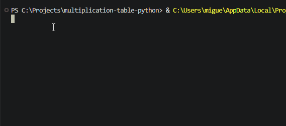

# Multiplication Table

A simple Python program that asks the user for a number and prints its multiplication table from 1 to 10.

## How to Run

Make sure you have Python installed. Clone the repository and open its folder:

```bash
git clone https://github.com/SEU-USUARIO/multiplication-table-python.git
cd multiplication-table-python
```

Run the program:

```bash
python main.py
```

Enter a number when prompted, and the program will display its multiplication table.

## Example

```text
7 * 1 = 7
7 * 2 = 14
7 * 3 = 21
7 * 4 = 28
7 * 5 = 35
7 * 6 = 42
7 * 7 = 49
7 * 8 = 56
7 * 9 = 63
7 * 10 = 70
```


## Demo


